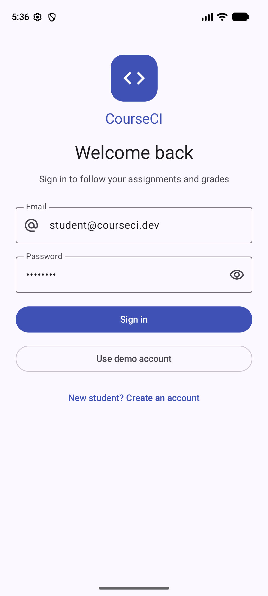
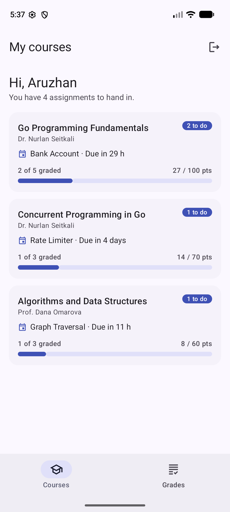
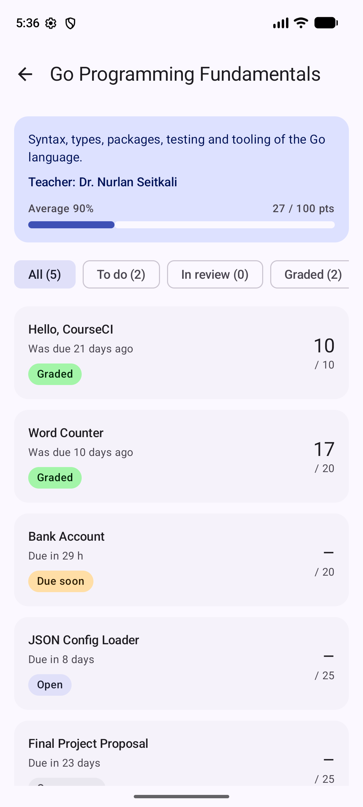
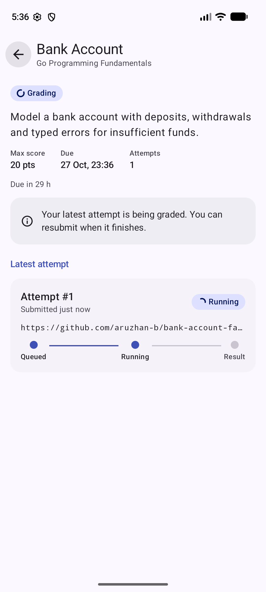
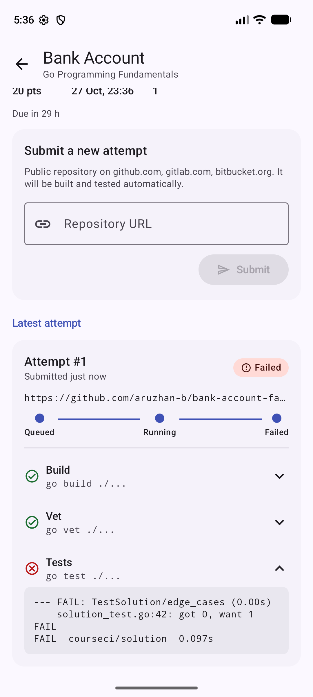
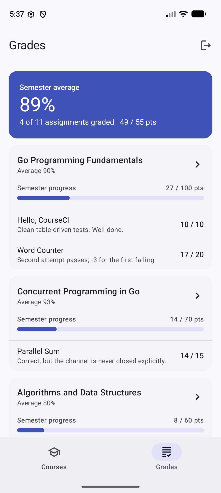

# CourseCI Android App

CourseCI is an automated assessment and grade management platform for programming courses. A teacher creates an assignment, the student submits a public Git repository, CourseCI builds and tests the code in an isolated container, and the teacher assigns the final grade.

This Android app is the **student-facing client**. A student can see their courses and deadlines, submit a repository, follow grading in real time, read the per-check feedback, and track grades and semester progress.

> The app runs fully offline against an in-memory fake backend whose models mirror the real Laravel API schema (`backend/`). Networking will replace the fake repository after connecting backend; the UI and ViewModels will not change.

## Screenshots

| Sign in | Courses | Course detail |
|---|---|---|
|  |  |  |

| Grading in progress | Grading feedback | Grades |
|---|---|---|
|  |  |  |

## Features

1. **Sign in and registration.** Email/password forms with field validation that matches the backend rules (valid email, password of at least 8 characters, 
matching confirmation). They show loading and error states and include a one-tap demo account. Public registration creates student accounts only.

2. **Courses and assignments.** Enrolled courses show the next deadline, a to-do count and semester progress. Each course lists its assignments with 
a status badge (Open, Due soon, Missing, Grading, Awaiting review, Graded), the deadline, and the score. Filter chips (All / To do / In review / Graded) narrow the list.

3. **Repository submission with live grading.** The student submits a public `https://` repository on GitHub, GitLab or Bitbucket. URLs with credentials, ports, 
query strings or extra paths are rejected. The attempt then moves through **Queued → Running → Passed / Failed / Timed out** on screen. Every check (`go build`, `go vet`, `go test`) shows its result and expandable output. Resubmission is allowed until the deadline, and earlier attempts stay in the history.

4. **Grades and semester progress.** Shows the semester average, per-course progress (points earned out of the course total), and every graded assignment with the teacher's feedback.

### Demo tips

- Use **"Use demo account"** on the sign-in screen (`student@courseci.dev` / `password`).
- The simulated grader decides the outcome from the repository name, so every result can be reproduced:

  | Repository name contains | Result |
  |---|---|
  | `broken` | build fails |
  | `fail` | tests fail |
  | `slow` | run times out |
  | anything else | all checks pass |

  For example, submit `https://github.com/you/bank-account-fail` for a failing run, then `https://github.com/you/bank-account` to see attempt #2 pass.
- Deadlines are generated relative to the current time, so the demo always contains open, due-soon, missing and graded work.
- A newly registered student has no enrollments yet and sees the empty state.

## Architecture

```
ui/            Compose screens, ViewModels, reusable components, theme, navigation
 ├─ auth/        Login + Register (AuthFormViewModel)
 ├─ courses/     Courses list (CoursesViewModel)
 ├─ course/      Course detail + filters (CourseDetailViewModel)
 ├─ assignment/  Assignment detail, submit form, grading result (AssignmentDetailViewModel)
 ├─ grades/      Grades and semester progress (GradesViewModel)
 ├─ components/  StatusPill, ScoreProgress, FormTextField, PasswordTextField, cards, …
 ├─ navigation/  Type-safe routes + NavHost with bottom bar and auth gate
 └─ theme/       Material 3 color scheme, shapes, semantic status colors
domain/        Pure Kotlin logic: validators, assignment state, progress, CourseworkInteractor
data/          Models mirroring the API, repository interfaces, fake in-memory implementation
AppContainer   Manual dependency injection (one instance per process)
```

## Running

**Requirements:** Android Studio (recent stable), JDK 17+, Android SDK 37. `minSdk` is 26.

1. Open the `android/` folder in Android Studio (File → Open).
2. Let Gradle sync, choose an emulator or device, and press **Run**.

From the command line:

```bash
cd android
./gradlew assembleDebug          # build the APK
./gradlew installDebug           # install on a running emulator/device
```

## Tech stack

- Kotlin 2.4
- Jetpack Compose (BOM 2026.09)
- Material 3
- Navigation Compose 2.10
- Lifecycle ViewModel / runtime-compose 2.11
- Kotlin Coroutines & Flow
